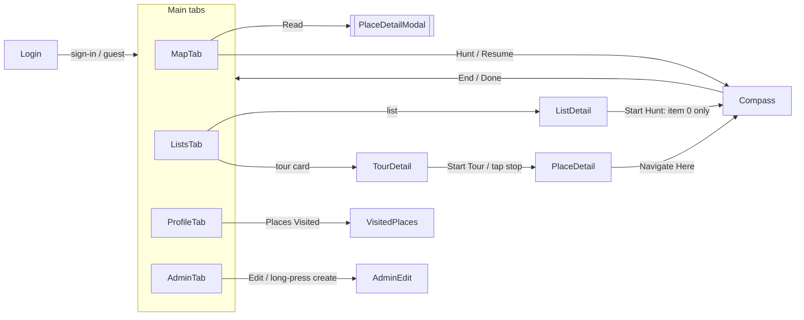
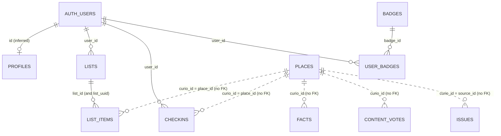

# 01 — Inventory of the Expo app

This is a read-only analysis of the original Expo / React Native app. The SwiftUI port is scoped against it.

| | |
|---|---|
| Source | `../curious-places-replit`, branch `replit-backup`, commit `8b44634` |
| Analysed | 2026-10-31 |
| Citations | `path:line`, relative to the Expo repo root |
| Tags | **CONFIRMED**: created by a file in `supabase/migrations/`. **INFERRED**: seen only in queries, types or UI code. |

Three caveats apply to everything below:

1. **The migrations are incomplete.** The four files in `supabase/migrations/` create only `badges`, `checkins`, `user_badges`, `lists` and `list_items`. The code also uses `places`, `facts`, `content_votes`, `issues` and `profiles`, plus extra columns on `lists` and `list_items`. The live database has moved on from what's committed.
2. **`replit.md` is stale.** It describes `categories`, `locations`, `regions` and `routes` tables, a Drizzle storage layer, and `/api/locations*` endpoints. None of these exist in the code. Where the docs and the code disagree, this inventory follows the code.
3. **Env vars appear by name only.** No secret values are reproduced here.

---

## 1. Summary

- **Architecture.** The app reads and writes Supabase directly with the anon key for auth, profiles, places, lists, check-ins and badges. It also calls an Express server on Replit for the map viewport, tours, audio, facts, votes and issue reports. The server uses the **service-role key** and has **no authentication**.
- **Content model.** The core content is the `places` table. Each place is identified by `curio_id` (`CURIO-<n>`) and has English text plus 10 translated `{lang}_detail_overview` columns. Every cross-table link is a text `curio_id` with **no foreign key**.
- **External services.** The only third-party API is **InWorld TTS** (`inworld-tts-1.5-max`), chosen over ElevenLabs on cost. It runs on the server and generates narration on demand, which is cached in private Supabase Storage buckets. **ElevenLabs, OpenAI and translation APIs are not used.** Nothing in the repo shows how the translated text columns get filled.
- **Box IDs.** These index an 83 × 68 grid over Greater London. The admin web tool computes them on the fly. *Correction from the pulled live schema:* they are also stored, in `places.box_id`, written by an external loader. The mobile app never uses them. H3 cells replace them for new work (`supabase/proposed/08_h3_cells.sql`).
- **Background jobs.** There are no Edge Functions, cron jobs or views. There is one RPC, `get_user_progress`. *Correction from the pulled live schema:* `places` has one trigger, `set_updated_at`.
- **Unfinished features.** Tour stop-to-stop progression was never built: "Start Tour" opens stop 1 only. The badge-unlocked modal and the confetti can never fire.
- **Security.** Every `/api/admin/*` endpoint is public. Users can grant themselves badges. The progress RPC can read any user's data. See §10.
- **Most serious bug.** New place IDs collide once there are 1,000 or more places. After that, every place created from the in-app admin screen gets the same ID. See §10, item 1.

### Decisions so far

| # | Decision | Reason / consequence |
|---|---|---|
| D1 | **Keep InWorld TTS.** It was chosen over ElevenLabs on cost. | The port keeps InWorld's voices and the existing audio cache layout (§3.4, §5). |
| D2 | **The iOS app uses only the Supabase anon key** (`SUPABASE_ANON_KEY`) plus the signed-in user's session. **Never the service-role key.** | Every read and write from the app goes through RLS, so these need policies before the app can drop the Replit server: public SELECT on visible `places`, `facts`, and tour `lists` and `list_items`; INSERT on `content_votes` and `issues` keyed on `auth.uid()`; and, if admin comes to iOS, admin writes gated on `profiles.admin_flag`. TTS generation still needs a server-side secret (`INWORLD_API_KEY`), so it has to stay on a server or move to an Edge Function. See §7.3. |

---

## 2. Screens and navigation

### 2.1 Shell

- **Provider tree** (`client/App.tsx:45-63`): ErrorBoundary → QueryClientProvider → ThemeProvider → AuthProvider → CheckinProvider → HuntProvider → TourProvider → NavigationContainer → RootStackNavigator.
- **Auth gate.** The gate is `isAuthenticated = session || isGuest` (`client/navigation/RootStackNavigator.tsx:50`). While auth is loading, the app shows a full-screen spinner and no navigator (`:42-48`).
- **Guest mode.** Guest mode is a boolean held in memory and is not persisted. It resets on every launch (`client/contexts/AuthContext.tsx:269-271`).
- **Admin access.** The Admin tab appears only when `profiles.admin_flag` is true (`AuthContext.tsx:312`, `MainTabNavigator.tsx:81-92`). The `AdminEdit` route is registered for every user (`RootStackNavigator.tsx:111`). The server checks nothing.
- **Theme.** The app is dark by default. Light, dark or system is stored in AsyncStorage under `@lantern_theme_preference`. ThemeProvider renders `null` until that value loads (`ThemeContext.tsx:51-53`).

### 2.2 Routes

| Route | Component | Presentation | Params |
|---|---|---|---|
| `Login` (unauthenticated only) | LoginScreen | no header | — |
| `Main` | MainTabNavigator | no header | — |
| ↳ tab `MapTab` "Explore" | MapScreen | tab | — |
| ↳ tab `ListsTab` "Tours" | ListsScreen | tab | — |
| ↳ tab `ProfileTab` "Profile" | ProfileScreen | tab | — |
| ↳ tab `AdminTab` "Admin" (admins only) | AdminMapScreen | tab | — |
| `Compass` | CompassScreen | full-screen modal, slides from the bottom | `{ fromTour?: boolean }` |
| `ListDetail` | ListDetailScreen | push | `{ listId, listName }` |
| `TourDetail` | TourDetailScreen | push | `{ tourId }` |
| `PlaceDetail` | PlaceDetailScreen | push, `getId = placeId` | `{ placeId, placeName, placeDescription?, placeLat, placeLng, tourId?, tourName? }` |
| `VisitedPlaces` | VisitedPlacesScreen | push | — |
| `AdminEdit` | AdminEditScreen | push | `{ curioId, curioName, isNew?, latitude?, longitude? }` |

Route definitions are in `client/navigation/RootStackNavigator.tsx:16-125` and `client/navigation/MainTabNavigator.tsx:27-92`. On iOS the tab bar is transparent with a blur behind it.

### 2.3 Navigation edges



| From | Trigger | To | Cite |
|---|---|---|---|
| Login | Sign-in or "Continue as Guest" | Main. The auth state changes; there is no `navigate` call. | `LoginScreen.tsx:132-250` |
| MapScreen | Tap a marker | Bottom panel, same screen | `MapScreen.tsx:370-372` |
| MapScreen | "Read" / "Read more" | PlaceDetailModal, an in-screen modal (not the PlaceDetail route) | `MapScreen.tsx:343-346, 1178-1182` |
| MapScreen | "Hunt" | Sets the target, frames the map, then goes to `Compass` after 600 ms | `MapScreen.tsx:352-368` |
| MapScreen | "Resume Compass" pill | `Compass` | `MapScreen.tsx:378-380` |
| MapScreen | "Save" as guest, then "Sign In" | `signOut()`, which returns to Login | `MapScreen.tsx:382-393` |
| ListsScreen | Tap a list | `ListDetail` | `ListsScreen.tsx:130-132` |
| ListsScreen | Tap a tour | `TourDetail` | `ListsScreen.tsx:134-136` |
| ListsScreen | Guest "Sign In" | `navigate('Login')`. **Broken:** the route isn't registered for guests. | `ListsScreen.tsx:287` |
| ProfileScreen | "Places Visited" | `VisitedPlaces` | `ProfileScreen.tsx:335-337` |
| ListDetailScreen | "Start Hunt" | `Compass`, targeting only the first item | `ListDetailScreen.tsx:117-132` |
| TourDetailScreen | "Start Tour" / tap a stop | `PlaceDetail` with `tourId` and `tourName` | `TourDetailScreen.tsx:62-92` |
| PlaceDetailScreen | "Navigate Here" | `Compass` with `{fromTour}` | `PlaceDetailScreen.tsx:390-399` |
| CompassScreen | End / Complete / Done | `goBack()` if `fromTour`, otherwise `Main` | `CompassScreen.tsx:291-298` |
| AdminMapScreen | "Edit" / long-press, then create | `AdminEdit` | `AdminMapScreen.tsx:174-210, 373` |

**Reachability notes**
- The `PlaceDetail` route is reached **only from tours**. The map uses `PlaceDetailModal`, a near-duplicate of about 1,100 lines. Port both as a single view.
- Web-only placeholder screens, not needed for the port: `MapScreen.web.tsx`, `AdminMapScreen.web.tsx`, `AdminEditScreen.web.tsx`, `SafeMapView.web.tsx`, `PagerViewCompat.web.tsx`.
- Once someone is a guest, the only way back to Login is `signOut()`. The MapScreen "Save" prompt does this.

### 2.4 What each screen does

| Screen / component | Purpose |
|---|---|
| **LoginScreen** | Hero image ("Discover Hidden London"), Google OAuth, email sign-in and sign-up (optional full name, password of at least 6 characters), "Continue as Guest". |
| **MapScreen** (1,730 lines) | Custom-styled Google-provider map. Loads viewport places from `/api/map/viewport`. Markers have four states: ambient, target, checked-in and greyed. Filter chips use `attributes.physical.setting`. Has a legend, search (DB places plus the OS geocoder), a bottom panel (Save / Read / Hunt), a save-to-list modal, and a "zoom in" banner when more than 150 places are in view. |
| **PlaceDetailModal** | Page-sheet place detail opened from the map. Plays audio narration, shows facts, takes votes and issue reports. Has a fact thumbs-up that is local only. Audio keeps playing when the user taps through to the map. |
| **PlaceDetailScreen** | Pushed place detail, used from tours. Static mini-map hero, votes, "Navigate Here", audio with signed-URL polling, a localised description (right-to-left for Arabic), "Did you know?" facts with fact audio (English only), a report-issue modal, and "Back to {tour}". |
| **CompassScreen** | Full-screen hunt. A pager with two pages: page 0 is HuntMapView; page 1 is a compass dial and bearing arrow showing distance, ± accuracy and DMS coordinates. Check-in and remove check-in, an "arrived" view under 10 m, CheckinSuccessModal. |
| **HuntMapView** | User and target on a map. Pulse rings appear under 1 km and speed up from 2,000 ms to 400 ms as the user gets closer, over 4 tiers. Shows a "distance · cardinal direction" overlay. |
| **CheckinSuccessModal** | Gradient celebration. It invents "achievements" and points that are never stored. |
| **ListsScreen** | Segmented "Official Tours" / "My Lists". Tours are grouped by start region, with a "Featured" (promoted) section and hero images. Lists support swipe-to-delete and creation. |
| **ListDetailScreen** | Inline rename, long-press drag to reorder, swipe to remove, "Start Hunt". |
| **TourDetailScreen** | Static map with a polyline and start/finish pins, stats (length, duration, stops), description, numbered stops, "Start Tour". |
| **ProfileScreen** | Signed in: passport card, trophy case (all badges, earned ones lit), recent visits with remove, theme picker, description-language picker (11 options), sign out. Guest: a Google prompt and the theme picker. |
| **VisitedPlacesScreen** | Every check-in, newest first, with remove. |
| **AdminMapScreen** | Places within 1 km as plain pins, "Search here", admin search, random place, long-press to create, Edit / Delete. |
| **AdminEditScreen** | Edit the name and `detail_overview`, edit or delete facts, and import JSON (`DETAIL-OVERVIEW` plus up to 10 `FACTS`, which replaces all existing facts). |
| **SafeMapView** | Wraps `react-native-maps` in an error boundary. |

**Contexts**
- **AuthContext:** session, profile, guest, admin and language.
- **CheckinContext:** the set of checked-in place IDs plus a refresh counter.
- **HuntContext:** `activeTarget`.
- **TourContext:** effectively dead (§10).
- **ThemeContext:** the theme preference.

---

## 3. Data model

### 3.1 Tables

#### `places` — INFERRED (no migration)

The core content table. The anon client reads it directly (`client/lib/supabase.ts:106-153, 226-327`). The server reads and writes it with the service role.

| Column | Type (inferred) | Notes / evidence |
|---|---|---|
| `places_id` | uuid, no constraint | Admin update key (`server/routes.ts:163-188`). *Correction from the pulled live schema:* not the primary key. |
| `curio_id` | text, **primary key** (live schema) | `CURIO-<n>`. The lookup key everywhere (`supabase.ts:116`, `routes.ts:210,1002,1180`). Uniqueness is enforced only in app code (`routes.ts:889-902`). |
| `name` | text | Searched with `ilike` (`supabase.ts:152`, `routes.ts:1321`) |
| `lat`, `lon` | double | Bounding-box filters (`supabase.ts:249-252`, `routes.ts:1441-1442`) |
| `plus_code` | text, nullable | Open Location Code, computed in the browser (`server/templates/admin-map.html:524-552`) |
| `detail_overview` | text, nullable | English description (`routes.ts:132,187`, `supabase.ts:111`) |
| `fr_`, `de_`, `es_`, `it_`, `zh_`, `hi_`, `ar_`, `ja_`, `pt_`, `ko_detail_overview` | text, nullable | Translations (`supabase.ts:77-108`, `routes.ts:67-77, 1431-1435`) |
| `visible_flag` | boolean | Every app query filters `= true` (`supabase.ts:151,248`, `routes.ts:1003,1440`) |
| `attributes` | jsonb, nullable | Structured tags, shape below. Used for map filters and the admin graph. |
| `curio_type` | text? | Read only, for marker styling (`supabase.ts:171`, `MapScreen.tsx:74-104`). Not selected by `/api/map/viewport`. |
| `detail_audio_path` | text? | Read only, to show the "Audio" badge (`MapScreen.tsx:1010`). The actual audio comes from Storage (§3.4). |
| `location` | geography(Point, 4326) | From the pulled live schema: generated from `lon`/`lat`, with GIST indexes. PostGIS is enabled. No app reads it. |
| `box_id` | integer, nullable | From the pulled live schema: the London box ID (§9), written by an external loader. No app reads it. |
| `h3_hex_r7_id`, `h3_hex_r9_id` | text | Proposed in `supabase/proposed/08_h3_cells.sql`: H3 cells, filled by the `h3-index` Edge Function. |

`attributes` shape (`routes.ts:1585-1624`, `supabase.ts:50-64`):
```
physical        { setting, visibility, best_experienced, weather_dependent: bool,
                  accessibility_notes, estimated_dwell_minutes: number }
temporal        { century_tag, primary_era, secondary_eras[], specific_dates }
thematic        { primary_theme, secondary_themes[], sub_themes[] }
narrative       { mood, secondary_mood, narrative_type, notable_people[{ name }] }
walk_utility    { walk_role, photo_moment, sensitivity_flag }
content_utility { depth_rating, standalone_interest, tour_pack_candidates[] }
```

- **Fallback key names.** The client also tries `latitude`/`longitude`/`x`/`y`, `title`, `description`, `curio-id`, `detail-overview` and similar (`supabase.ts:83-97, 164-206`). These are defensive fallbacks and probably not real columns.
- **Old naming.** `admin-places.html` uses hyphenated keys, which suggests an older naming scheme.
- **Deletes.** Facts are deleted by hand before a place is deleted (`routes.ts:735-747`), so there's probably no cascading foreign key.

#### `facts` — INFERRED

The server is the only thing that touches this table.

| Column | Notes |
|---|---|
| `id` | PK (`routes.ts:343, 593, 638`) |
| `curio_id` | text, linked to `places.curio_id` with no foreign key (`routes.ts:344, 564`) |
| `fact_info` | text (`routes.ts:343, 564`). PATCH tries `fact`, `content`, `text` and `fact_text` first (`routes.ts:605-607`). |
| `created_at` | timestamp. Fact order, and therefore the fact audio filenames, depends on it (`routes.ts:345`). |

#### `content_votes` — INFERRED

Server only. The code comment says it "may not exist" (`routes.ts:440`).

| Column | Notes |
|---|---|
| `curio_id` | text |
| `vote_type` | `'up'` \| `'down'` |
| `user_id` | uuid, nullable. Taken from the request body and never verified (`routes.ts:423-470`). |

#### `issues` — INFERRED

Server only.

| Column | Notes |
|---|---|
| `source_id` | text: a `curio_id` or a fact id |
| `source_type` | `'place'` \| `'fact'` |
| `issue_type` | `incorrect_location` \| `incorrect_info` \| `typo` \| `bad_audio` \| `offensive` \| `other` (`PlaceDetailScreen.tsx:63-70`) |
| `user_id` | uuid, nullable, unverified |
| `other_desc` | text of at most 200 characters, enforced in code (`routes.ts:502`) |

#### `profiles` — CREATE INFERRED; one column CONFIRMED

| Column | Tag | Notes |
|---|---|---|
| `id` | INFERRED | Equals `auth.users.id` (`AuthContext.tsx:102`) |
| `email`, `full_name`, `avatar_url` | INFERRED | Upserted by the client (`AuthContext.tsx:170-177, 241-243`). Avatar and name are back-filled from Google metadata (`:106-118`). |
| `admin_flag` | INFERRED | Read only, probably `DEFAULT false` (`AuthContext.tsx:166, 312`) |
| `preferred_language` | **CONFIRMED** | `TEXT DEFAULT NULL`, with `CHECK (NULL or IN ('fr','de','es','it','zh','hi','ar','ja','pt','ko'))` (`add_preferred_language.sql:3-11`). NULL means English. |

- **RLS:** not in the repo, but the client selects, updates and upserts its own row.
- **Row creation:** the sign-up upsert runs before there's a session if email confirmation is on (`AuthContext.tsx:241`). So an auth trigger probably creates `profiles` rows in the live database, but there's no trigger in the repo.

#### `lists` — base CONFIRMED (`create_lists_tables.sql:5-11`); altered by `add_tours_columns.sql:5-8`

User lists and official tours share this table. Tours have `list_type = 'tour'`.

| Column | Tag | Type / default |
|---|---|---|
| `id` | CONFIRMED | `UUID PK DEFAULT gen_random_uuid()` |
| `user_id` | CONFIRMED | `UUID NOT NULL → auth.users(id) ON DELETE CASCADE` |
| `name` | CONFIRMED | `TEXT NOT NULL` |
| `created_at`, `updated_at` | CONFIRMED | `TIMESTAMPTZ DEFAULT NOW()`. No trigger: `updated_at` is set by hand (`lists.ts:74`, `routes.ts:1116`). |
| `description` | CONFIRMED | `TEXT` |
| `list_type` | CONFIRMED | `TEXT DEFAULT 'list' CHECK IN ('list','tour')` |
| `metadata` | CONFIRMED | `JSONB DEFAULT '{}'`, shaped `{ difficulty?: Easy\|Moderate\|Challenging, duration?, distance?, hero_image?, tour_start_region? }` (`shared/schema.ts:9-15`) |
| `tour_id` | INFERRED | A human-readable tour code, separate from `id` (`routes.ts:1096`) |
| `tour_length` | INFERRED | text (`routes.ts:1092`, `ListsScreen.tsx:214`) |
| `tour_length_category` | INFERRED | `Short` \| `Medium` \| `Long` \| `Half Day` (`server/admin-tours.html:89`) |
| `tour_start_region`, `tour_end_region` | INFERRED | text (`routes.ts:1094-1095`). The start region also appears inside `metadata`. |
| `promoted_flag` | INFERRED | boolean, shown as "Featured" (`routes.ts:1124`, `ListsScreen.tsx:139`) |

- **Indexes:** `idx_lists_user_id (user_id)`, `idx_lists_list_type (list_type)`.
- **Tour ownership:** every tour is owned by one hard-coded user UUID (`routes.ts:1090`).

#### `list_items` — base CONFIRMED (`create_lists_tables.sql:33-44`)

| Column | Tag | Type |
|---|---|---|
| `id` | CONFIRMED | `UUID PK` |
| `list_id` | CONFIRMED | `UUID NOT NULL → lists(id) ON DELETE CASCADE` |
| `place_id` | CONFIRMED | `TEXT NOT NULL`. Holds a `curio_id`. |
| `place_name` | CONFIRMED | `TEXT NOT NULL`. Denormalised copy. |
| `place_description` | CONFIRMED | `TEXT` |
| `place_latitude`, `place_longitude` | CONFIRMED | `DOUBLE PRECISION NOT NULL` |
| `order_index` | CONFIRMED | `INTEGER NOT NULL DEFAULT 1` |
| `created_at` | CONFIRMED | `TIMESTAMPTZ DEFAULT NOW()` |
| `list_uuid` | INFERRED | A second list key. Every tour query filters on it (`routes.ts:952, 993, 1146, 1228`). The client falls back to it (`lists.ts:104`). |
| `list_item_uuid` | INFERRED | An alternate row id, used for tour-item delete and reorder (`routes.ts:1192, 1260, 1279`) |
| `place_uuid` | INFERRED | Selected once and never used (`routes.ts:951`) |

- **Unique constraint:** `UNIQUE(list_id, place_id)`. The client treats a `23505` error as "already in list".
- **Indexes:** `idx_list_items_list_id`, `idx_list_items_order (list_id, order_index)`.
- **Live schema differs:** the server inserts tour items **without** `place_name`, `place_latitude` or `place_longitude` (`routes.ts:1232-1237`). That can only succeed if the live table differs from this migration.

#### `checkins` — CONFIRMED (`create_checkins_badges_tables.sql:16-25`)

| Column | Type |
|---|---|
| `id` | `UUID PK DEFAULT gen_random_uuid()` |
| `user_id` | `UUID NOT NULL → auth.users(id) ON DELETE CASCADE` |
| `place_id` | `TEXT NOT NULL`, a `curio_id` with no foreign key |
| `place_name` | `TEXT NOT NULL` |
| `place_latitude`, `place_longitude` | `DOUBLE PRECISION NOT NULL` |
| `checked_in_at` | `TIMESTAMPTZ DEFAULT NOW()` |

- **Unique constraint:** `UNIQUE(user_id, place_id)`.
- **Indexes:** `idx_checkins_user_id`, `idx_checkins_place_id`.

#### `badges` — CONFIRMED (`create_checkins_badges_tables.sql:5-13`)

| Column | Type |
|---|---|
| `id` | `UUID PK` |
| `name` | `TEXT NOT NULL UNIQUE` |
| `description` | `TEXT NOT NULL` |
| `icon_name` | `TEXT NOT NULL DEFAULT 'award'`. A Feather icon name. |
| `requirement_type` | `TEXT NOT NULL CHECK IN ('checkin_count','tour_complete','category','special')` |
| `requirement_value` | `INTEGER DEFAULT 1` |
| `created_at` | `TIMESTAMPTZ DEFAULT NOW()` |

Seed rows (`:65-72`):

| Name | Icon | Rule |
|---|---|---|
| The Explorer | compass | 1 check-in |
| The Wanderer | map-pin | 5 check-ins |
| The Historian | book-open | 10 check-ins |
| The Legend | star | 25 check-ins |
| Tour Guide | flag | `tour_complete` 1. **Never awarded**, because tour completion doesn't exist. |

#### `user_badges` — CONFIRMED (`create_checkins_badges_tables.sql:28-34`)

| Column | Type |
|---|---|
| `id` | `UUID PK` |
| `user_id` | `UUID NOT NULL → auth.users(id) ON DELETE CASCADE` |
| `badge_id` | `UUID NOT NULL → badges(id) ON DELETE CASCADE` |
| `earned_at` | `TIMESTAMPTZ DEFAULT NOW()` |

- **Unique constraint:** `UNIQUE(user_id, badge_id)`.
- **Index:** `idx_user_badges_user_id`.

### 3.2 Relationships



- **No embedded selects.** There are no PostgREST embedded selects such as `places(*)` anywhere. The tour-to-place join is done by hand in JS (`routes.ts:998-1027`), and it silently drops stops whose place has `visible_flag = false`.

### 3.3 RLS policies (all CONFIRMED, quoted verbatim)

| Table | Policy | Command | Expression |
|---|---|---|---|
| `badges` | "Anyone can view badges" | SELECT | `USING (true)` |
| `checkins` | "Users can view their own checkins" | SELECT | `USING (auth.uid() = user_id)` |
| `checkins` | "Users can insert their own checkins" | INSERT | `WITH CHECK (auth.uid() = user_id)` |
| `user_badges` | "Users can view their own badges" | SELECT | `USING (auth.uid() = user_id)` |
| `user_badges` | "Users can insert their own badges" | INSERT | `WITH CHECK (auth.uid() = user_id)` |
| `lists` | "Users can view own lists" | SELECT | `USING (auth.uid() = user_id)` |
| `lists` | "Users can create own lists" | INSERT | `WITH CHECK (auth.uid() = user_id)` |
| `lists` | "Users can update own lists" | UPDATE | `USING (auth.uid() = user_id)` (no WITH CHECK) |
| `lists` | "Users can delete own lists" | DELETE | `USING (auth.uid() = user_id)` |
| `lists` | "Anyone can view official tours" | SELECT | `USING (list_type = 'tour')`. **Probably never applied:** it's written as `CREATE POLICY IF NOT EXISTS`, which Postgres doesn't support (`add_tours_columns.sql:32`). |
| `list_items` | "Users can view items in own lists" | SELECT | `USING (EXISTS (SELECT 1 FROM lists WHERE lists.id = list_items.list_id AND lists.user_id = auth.uid()))` |
| `list_items` | "Users can add items to own lists" | INSERT | `WITH CHECK (` same `EXISTS` `)` |
| `list_items` | "Users can update items in own lists" | UPDATE | `USING (` same `)` |
| `list_items` | "Users can delete items from own lists" | DELETE | `USING (` same `)` |

- **Unknown RLS:** for `places`, `facts`, `content_votes`, `issues` and `profiles`, RLS isn't in the repo. `places` must allow anonymous SELECT, because the client reads it directly.
- **Tours are read through the server.** `list_items` has no public SELECT policy, so tours only work because the server reads them with the service-role key.

### 3.4 Functions, storage, Edge Functions and auth

**RPC: `get_user_progress(uid UUID) RETURNS JSON`**
- Defined in `create_checkins_badges_tables.sql:75-108` as `plpgsql SECURITY DEFINER`, with no `search_path` and **no `auth.uid() = uid` check**.
- Returns:
  ```
  { total_checkins, total_badges,
    badges: [{ id, name, description, icon_name, earned_at }],
    recent_checkins: [{ id, place_id, place_name, checked_in_at }] }   // latest 20
  ```
- Called at `client/lib/checkins.ts:34`.

**Storage.** Only the server touches Storage, using the service role (`routes.ts:39-97`).

| Bucket | Contents | Path pattern |
|---|---|---|
| `en_audio` | English overview, English fact audio, loading clip | `en_curio_{N}_detail_overview.mp3`, `en_curio_{N}_fact_{NN}_v2.mp3`, `en_loading_overview.mp3` |
| `fr_audio`, `de_audio`, `it_audio`, `pt_audio`, `es_audio`, `ja_audio`, `ar_audio`, `zh_audio`, `ko_audio`, `hi_audio` | Translated overview audio | `{lang}_curio_{N}_detail_overview.mp3` |
| `audio_overviews_{start}_{start+999}` *(legacy)* | Pre-generated audio that the old build (`server_dist/index.js:94-125`) referenced | `{f}-{f+99}/curio_detail_{N}.mp3`, `{f}-{f+99}/curio_{N}_{factId}.mp3` |

- `N` is the number at the end of `curio_id`. `NN` is the fact's position by `created_at`, starting at 01 and zero-padded.
- **Bucket creation:** buckets are created private on demand (`ensureBucket`, `routes.ts:81-97`). This only happens on the non-English path; `en_audio` must already exist.
- **Access:** every audio URL is a `createSignedUrl(…, 3600)`, valid for one hour (`routes.ts:46-51`). `getPublicUrl` is never used.

**Edge Functions:** none. There is no `functions.invoke` anywhere. There are also no views and no triggers.

**Auth** (`client/contexts/AuthContext.tsx`, `client/lib/supabase.ts:11-48`)
- Email and password: `signInWithPassword` (`:220`) and `signUp` with `options.data.full_name` (`:230-234`).
- Google OAuth:
  - `signInWithOAuth({provider:'google', skipBrowserRedirect:true})` (`:277-280`) opens `WebBrowser.openAuthSessionAsync`.
  - The tokens are parsed from the URL fragment (**implicit flow**) and then passed to `setSession` (`:285-297`).
  - Redirect URL: `lantern://auth/callback` (`supabase.ts:11-18`).
- Sessions are stored in AsyncStorage, with `autoRefreshToken`, `persistSession` and `detectSessionInUrl: false`.
- **Not used:** Sign in with Apple, anonymous auth, magic links, password reset.

### 3.5 Identifier schemes

| ID | Where | Format / notes |
|---|---|---|
| `curio_id` | `places` and every child table | `CURIO-<int>`, not zero-padded (`routes.ts:855` regex `^CURIO-(\d+)$`). The audio code uses only the number at the end. |
| `places_id` | `places` | A separate PK, used only by `PATCH /api/admin/places/:id` |
| `tour_id` | `lists` | A free-text tour code, separate from `lists.id` |
| `plus_code` | `places` | An Open Location Code, encoded in the browser |
| box ID | `places.box_id`, also computed by the admin tool | See §9 |
| H3 cells | `places.h3_hex_r7_id`, `h3_hex_r9_id` (proposed) | See `supabase/proposed/08_h3_cells.sql` |

---

## 4. Supabase calls by screen

These are all **client** calls. They use the anon key and the user's JWT, so they're subject to RLS. Express calls are listed alongside so each screen's data paths are in one place. The server's own Supabase usage is in §7.

### AuthContext (on launch and on every auth change; not tied to a screen)

| Op | Target | Detail | Cite |
|---|---|---|---|
| auth | `getSession()` | On mount | `AuthContext.tsx:69` |
| auth | `onAuthStateChange` | Every event: fetch the profile, or clear it | `:80-90` |
| select | `profiles` | `*` where `id = uid`, `.single()` | `:99-103` |
| update | `profiles` | `{avatar_url, full_name}`, filled from Google metadata if missing or different | `:106-118` |
| update | `profiles` | `{preferred_language}`, a one-time backfill from AsyncStorage | `:135-155` |
| upsert | `profiles` | `{id, email, full_name, avatar_url}` if the select returned nothing. The error is ignored. | `:170-177` |

### CheckinContext (on mount and when the user or guest state changes; feeds the map markers)

| Op | Target | Detail | Cite |
|---|---|---|---|
| select | `checkins` | `place_id` where `user_id` | `checkins.ts:265-268` |

### LoginScreen

| Op | Target | Detail | Cite |
|---|---|---|---|
| auth | `signInWithPassword` | | `AuthContext.tsx:220` |
| auth | `signUp` | `options.data.full_name` | `:230-238` |
| upsert | `profiles` | `{id, email, full_name, avatar_url: null}`, straight after sign-up | `:241-247` |
| auth | `signInWithOAuth` (google), then `setSession` | Implicit flow through the web browser | `:277-297` |

### MapScreen (with PlaceDetailModal)

| Op | Target | Detail | Cite |
|---|---|---|---|
| **Express** | `GET /api/map/viewport` | `latMin, latMax, lngMin, lngMax` (viewport plus 30% each side), `lang`. Refetched after a 100 m move, debounced 350 ms. | `supabase.ts:331-356`, `MapScreen.tsx:609-672` |
| select | `places` | Search: `*` where `visible_flag`, `.or(name.ilike, detail-overview.ilike)`, limit 5. **The hyphenated column name looks wrong.** | `supabase.ts:148-153` |
| OS | `Location.geocodeAsync("<q>, London, UK")` | Search results from addresses | `MapScreen.tsx:546` |
| select / insert | `lists` | `getUserLists` (see Lists) and `createList` `{user_id, name}` | `lists.ts:5-47` |
| count + insert | `list_items` | Count by `list_id`, then insert `{list_id, place_id, place_name, place_description, place_latitude, place_longitude, order_index: count+1}`. A `23505` error means "already saved". | `lists.ts:119-144` |
| select | `places` | Modal: `detail_overview` plus `{lang}_detail_overview` where `curio_id`, `.single()` | `supabase.ts:106-129`, `PlaceDetailModal.tsx:85` |
| **Express** | `GET /api/places/:id/audio-url?lang=` | Polled every 3 s until `isReady` | `PlaceDetailModal.tsx:159-192` |
| **Express** | `GET /api/places/:id/facts`, `GET …/fact-audio/:factId` | | `PlaceDetailModal.tsx:224-241, 308` |
| **Express** | `POST` / `DELETE /api/content/vote`, `POST /api/content/issue` | `{curioId, voteType, userId}` and `{sourceType, sourceId, issueType, otherDesc, userId}` | `PlaceDetailModal.tsx:370-473` |

### CompassScreen (with CheckinSuccessModal)

| Op | Target | Detail | Cite |
|---|---|---|---|
| select | `checkins` | `id` where `user_id` and `place_id`, `.single()`. `PGRST116` means not checked in. | `checkins.ts:107-112` |
| insert | `checkins` | `{user_id, place_id, place_name, place_latitude, place_longitude}`. `23505` counts as success. | `checkins.ts:74-98` |
| count | `checkins` | Total for the user | `checkins.ts:129-132` |
| select | `badges` | `requirement_type = 'checkin_count'` and `requirement_value <= total` | `checkins.ts:136-140` |
| select / insert | `user_badges` | Existing `badge_id`s, then one insert per new badge. **The client awards its own badges.** | `checkins.ts:144-156` |
| delete | `checkins` | Remove a check-in. **There is no DELETE policy, so this silently does nothing.** | `checkins.ts:225-229` |
| count ×2 | `checkins` | Visits to this place, and total visits (success modal) | `checkins.ts:184-194` |

### ProfileScreen

| Op | Target | Detail | Cite |
|---|---|---|---|
| select | `badges` | `*` ordered by `requirement_value` | `checkins.ts:50-53` |
| rpc | `get_user_progress` | `{uid}` | `checkins.ts:34` |
| update | `profiles` | `{preferred_language}`. Falls back to AsyncStorage on error `42703`. | `AuthContext.tsx:192-216` |
| delete | `checkins` | Remove a recent visit (same issue as above) | `checkins.ts:225` |
| auth | `signOut`, `signInWithOAuth` (guest) | | `AuthContext.tsx:258, 277` |

### VisitedPlacesScreen

| Op | Target | Detail | Cite |
|---|---|---|---|
| select | `checkins` | `*` where `user_id`, ordered by `checked_in_at` descending | `checkins.ts:245-249` |
| delete | `checkins` | Remove a visit | `checkins.ts:225` |

### ListsScreen

| Op | Target | Detail | Cite |
|---|---|---|---|
| select | `lists` | `*` where `user_id`, `list_type != 'tour'`, ordered by `created_at` descending | `lists.ts:5-11` |
| count | `list_items` | **One query per list** (N+1) | `lists.ts:24-27` |
| insert | `lists` | `{user_id, name}`. `list_type` is not set, so the database default applies. | `lists.ts:40-47` |
| delete | `lists` | where `id`. Relies on RLS and the cascade to `list_items`. | `lists.ts:58-61` |
| **Express** | `GET /api/tours` | Tours with `item_count` | `lists.ts:204` |

### ListDetailScreen

| Op | Target | Detail | Cite |
|---|---|---|---|
| select | `lists` | `*` where `id`, `.single()` | `lists.ts:187-191` |
| select | `list_items` | `*` where `list_id`, ordered by `order_index`. If empty, retries with `list_uuid`. | `lists.ts:86-112` |
| update | `lists` | `{name, updated_at}` | `lists.ts:72-75` |
| delete | `list_items` | where `id` | `lists.ts:150-153` |
| update ×n | `list_items` | `{order_index}` where `id` and `list_id`, one update per row, run in parallel | `lists.ts:167-173` |

### TourDetailScreen

| Op | Target | Detail | Cite |
|---|---|---|---|
| **Express** | `GET /api/tours/:tourId` | `{tour, stops}` | `lists.ts:223-235` |

### PlaceDetailScreen

| Op | Target | Detail | Cite |
|---|---|---|---|
| select | `places` | Localised description, same as the modal | `PlaceDetailScreen.tsx:140` |
| **Express** | audio-url, facts, fact-audio, vote, issue | Same as PlaceDetailModal | `PlaceDetailScreen.tsx:170-376` |

### AdminMapScreen and AdminEditScreen (admins only)

| Op | Target | Detail | Cite |
|---|---|---|---|
| select | `places` | `*` where `visible_flag`, ±1 km bounding box on `lat`/`lon`, limit 500, then a haversine filter. No language, so always English. | `supabase.ts:287-327` |
| **Express** | `GET /api/admin/places/search`, `/random` | | `AdminMapScreen.tsx:66-89` |
| **Express** | `POST /api/admin/place`, `DELETE /api/admin/place/:id` | Create or delete a place | `AdminMapScreen.tsx:186-226` |
| **Express** | `GET /api/admin/curio/:id`, `PATCH /api/admin/places/:placesId`, `PATCH /api/admin/place/:id/name`, `POST` / `PATCH` / `DELETE /api/admin/facts…` | Editing | `AdminEditScreen.tsx:66-224` |

**Dead helpers.** Defined and never called: `getNearest20` (`supabase.ts:366-429`), `getCheckinCount` (`checkins.ts:204-221`), `getTourById` (`lists.ts:242-245`).

**Error handling.** Almost every helper catches errors, logs them, and returns `[]`, `null` or `false`. The UI therefore can't tell "empty" from "failed". `createList` is the only exception: it throws.

**No auth header on Express calls.** None of them carries an `Authorization` header. User identity goes in the request body as `userId`, which the server doesn't verify.

---

## 5. External services

| Service | Called from | Purpose | Key / config |
|---|---|---|---|
| **InWorld TTS** `POST https://api.inworld.ai/tts/v1/voice` | Server only (`routes.ts:17-37`) | Narration MP3s for overviews (11 languages) and facts (English only) | `INWORLD_API_KEY`, sent as `Authorization: Basic …` |
| Supabase (PostgREST, Auth, Storage) | Client (anon key) and server (service role) | Everything | `EXPO_PUBLIC_SUPABASE_URL`, `EXPO_PUBLIC_SUPABASE_ANON_KEY`, `SUPABASE_SERVICE_ROLE_KEY` |
| Google OAuth | Through Supabase Auth (`AuthContext.tsx:277`) | Sign-in | Configured in the Supabase dashboard; not in the repo |
| Google Maps (provider) | `react-native-maps` with `PROVIDER_GOOGLE` on iOS (`MapScreen.tsx:718` and 4 other screens) | Map tiles with custom JSON styles (`client/constants/mapStyle.ts`) | **No iOS API key is configured in `app.json`** |
| OS geocoder | `Location.geocodeAsync` (`MapScreen.tsx:546`) | Address search | — |
| CARTO, OSM tiles; unpkg (Leaflet, markercluster, qr-code-styling) | Admin HTML only | Web admin maps | No keys |

**How InWorld is used**
- Model `inworld-tts-1.5-max`, temperature 1.1, MP3 output.
- Voices:
  - English overview: Olivia. English facts: Clive.
  - Other languages: fr Hélène, de Johanna, it Orietta, pt Beatriz, es Sofia, ja Asuka, ar Nour, zh Xiaoyin, ko Minji, hi Riya (`routes.ts:67-78`).

**Audio flow**
1. The client calls `GET /api/places/:curioId/audio-url?lang=`.
2. If the file is cached, the server returns a signed URL with `isReady: true`.
3. If not, the server starts a background TTS job and returns either the English loading clip or `null`, with `isReady: false`.
4. The client polls every 3 s, with no cap, until the file is ready (`PlaceDetailScreen.tsx:189-202`).

Fact audio works differently: it's generated during the request itself.

**Not used anywhere in the repo:** ElevenLabs (InWorld was picked instead on cost, see D1), OpenAI or any LLM, and any translation API. The `{lang}_detail_overview` columns are filled outside this codebase. The admin bulk import accepts JSON that was probably produced by an LLM elsewhere.

---

## 6. Dependencies and native iOS equivalents

Usage was checked by grepping imports across `client/`, `server/` and `shared/`.

| Package | Status | Used for (where) | iOS equivalent |
|---|---|---|---|
| `react`, `react-native` | used | Everything | SwiftUI |
| `expo` | used | Entry point, `reloadAppAsync` (ErrorFallback) | App lifecycle (not needed) |
| `@react-navigation/native`, `native-stack`, `bottom-tabs` | used | Root stack and tabs | `NavigationStack`, `TabView`, `.fullScreenCover`, `.sheet` |
| `@react-navigation/elements` | **unused** | — | — |
| `react-native-screens`, `react-native-safe-area-context` | used (peer) | Native screens and insets | Built in |
| `react-native-maps` | used | Maps on every map screen via `SafeMapView` (Google provider) | **MapKit** (`Map`, `Annotation`, `MapPolyline`, `MapCircle`). Map styling has to be redesigned; Google JSON styles don't carry over. |
| `expo-location` | used | Foreground location, `watchPositionAsync`, `watchHeadingAsync`, `geocodeAsync` | **CoreLocation**: `CLLocationManager` (location and `CLHeading`), `CLGeocoder` or `MKLocalSearch` |
| `expo-sensors` | used | Magnetometer fallback for the compass | CoreMotion, or drop it (`CLHeading` is enough on iPhone) |
| `geolib` | used | `getDistance`, `getGreatCircleBearing` (Compass, HuntMapView) | `CLLocation.distance(from:)` plus a small bearing function |
| `expo-audio` | used | Narration and fact audio players | **AVFoundation**: `AVPlayer` plus an `AVAudioSession` playback category |
| `expo-haptics` | used | Arrival and check-in feedback | `.sensoryFeedback` / `UINotificationFeedbackGenerator` |
| `@supabase/supabase-js` | used | All data access (client and server) | **supabase-swift** (already added) |
| `react-native-url-polyfill` | used | supabase-js support | Not needed |
| `expo-auth-session`, `expo-web-browser` | used | Google OAuth redirect and browser session | supabase-swift `signInWithOAuth` (uses `ASWebAuthenticationSession`); consider adding Sign in with Apple |
| `expo-linking` | imported, unused | `import * as Linking` is never referenced (`supabase.ts:4`) | URL scheme in Info.plist plus `.onOpenURL` |
| `@react-native-async-storage/async-storage` | used | Session, theme, language fallback | `UserDefaults` / `@AppStorage`; supabase-swift handles session storage itself |
| `expo-secure-store` | used only by dead code | `useDeviceId` (never imported) | Keychain, if needed |
| `@tanstack/react-query` | provider only | No `useQuery` or `useMutation` anywhere | async/await with `@Observable` models |
| `react-native-reanimated`, `react-native-worklets` | used | Marker pulses, drag-reorder, vote and modal animations | SwiftUI animations, `PhaseAnimator`, `TimelineView` |
| `react-native-gesture-handler` | used | Swipeable rows, pan for reordering | `.swipeActions`, `List` + `.onMove`, `DragGesture` |
| `react-native-pager-view` | used | Compass map/dial pager | `TabView` with `.tabViewStyle(.page)` |
| `react-native-keyboard-controller` | used | Keyboard-aware scroll | Built-in keyboard avoidance |
| `expo-blur` | used | Glass panels, tab bar | `.background(.ultraThinMaterial)` |
| `expo-glass-effect` | used | Liquid Glass detection (`useScreenOptions.ts:3`) | `.glassEffect()` (iOS 26+) |
| `expo-linear-gradient` | used | Tour hero, check-in modal | `LinearGradient` |
| `expo-image` | used | Avatar, login hero | `AsyncImage`, or a caching image loader |
| `@expo/vector-icons` | used | Feather icons everywhere (and `badges.icon_name`) | **SF Symbols**. Needs a mapping from Feather names, including the `badges.icon_name` values. |
| `react-native-confetti-cannon` | imported, dead | Never fires (`CompassScreen.tsx:22, 100`) | Drop it, or use a custom `Canvas` effect |
| `expo-status-bar` | used | Status bar style | `.preferredColorScheme` / `.toolbarColorScheme` |
| `expo-splash-screen` | config only | `app.json` plugin | Launch screen in Info.plist |
| `expo-constants`, `expo-font`, `expo-symbols`, `expo-system-ui` | **unused** | — | — |
| `react-dom`, `react-native-web` | web build only | — | Not ported |
| `express`, `http-proxy-middleware`, `tsx` | server only | Express server, Metro proxy, dev runner | Not ported (see §7) |
| `drizzle-orm`, `drizzle-zod`, `pg`, `ws`, `zod`, `zod-validation-error` | **unused** | Not imported anywhere | Not ported |
| dev: `drizzle-kit` | config only | `db:push` would push nothing (`shared/schema.ts` defines no tables) | — |
| dev: `babel-plugin-module-resolver`, eslint, prettier, typescript, `@types/*` | tooling | — | — |

---

## 7. Server-side logic on Replit

The server is defined in `server/index.ts` and `server/routes.ts`. It's deployed on Replit Cloud Run (`.replit`). A single Supabase client is created with the **service-role key** (`routes.ts:6-8`), so every query below bypasses RLS. **No route checks a session, JWT, API key or admin flag.** CORS limits browsers only (`index.ts:17-52`).

### 7.1 Routes

**Classes:**
- **APP:** called by the mobile app.
- **APP-ADMIN:** called by the in-app admin screens.
- **WEB-ADMIN:** called by an admin HTML tool.
- **STATIC:** pages and Expo plumbing.
- **DEAD:** no caller.

**Mobile app API**

| Method | Path | Class | Tables / services | Notes |
|---|---|---|---|---|
| GET | `/api/map/viewport` | APP | `places` | Bounding box with `visible_flag`, `limit(200)` and **no ORDER BY**, so dense areas get arbitrary results. Returns `{places:[{id: curio_id, name, description, latitude, longitude, attributes}]}`. `routes.ts:1419` |
| GET | `/api/tours` | APP | `lists`, `list_items` | Tours with `item_count` (N+1). `:930` |
| GET | `/api/tours/:tourId` | APP | `lists`, `list_items`, `places` | `{tour, stops}`. Joins on `curio_id` in JS and drops hidden places. `:975` |
| GET | `/api/places/:curioId/audio-url?lang=` | APP | `places`, Storage, InWorld | Signed URL, or starts background TTS. `:244` |
| GET | `/api/places/:curioId/fact-audio/:factId` | APP | `facts`, Storage, InWorld | TTS during the request, English only. `:328` |
| GET | `/api/places/:curioId/facts` | APP | `facts` | `:400` |
| POST / DELETE | `/api/content/vote` | APP | `content_votes` | Unverified `userId`. `:421, :451` |
| POST | `/api/content/issue` | APP | `issues` | `:487` |

**Admin API.** All of these are unauthenticated and use the service role.

| Method | Path | Class | Notes |
|---|---|---|---|
| GET | `/api/admin/places/needs-overview` | WEB-ADMIN | Places with no `detail_overview`. The comment says "sorted by box_id"; the code actually sorts by curio number. `:126` |
| PATCH | `/api/admin/places/:id` | WEB + APP-ADMIN | `:id` is `places_id`. Updates `detail_overview` but never regenerates audio. `:163` |
| GET | `/api/admin/places/extract/:curioId` | WEB-ADMIN | Full row as JSON. `:203` |
| GET | `/api/admin/places/lookup/:curioId` | **DEAD** | `:224` |
| GET | `/api/admin/curio/:curioId` | WEB + APP-ADMIN | `{place, facts}`. `:523` |
| POST / PATCH / DELETE | `/api/admin/facts[/:id]` | WEB + APP-ADMIN | `:554, :580, :631` |
| POST | `/api/admin/place` | APP-ADMIN | Creates a place. **The next-ID calculation sorts as text and can collide** (§10). `:652` |
| PATCH | `/api/admin/place/:curioId/name` | APP-ADMIN | `:703` |
| DELETE | `/api/admin/place/:curioId` | APP-ADMIN | Deletes the place and its facts. Leaves votes, issues, list items and audio behind. `:731` |
| GET | `/api/admin/places/nearby` | WEB-ADMIN | Haversine over the **whole table**, paged 1,000 at a time. `:761` |
| GET | `/api/admin/places/next-curio-id` | WEB-ADMIN | Correct numeric max. `:823` |
| POST | `/api/admin/places` | WEB-ADMIN | A second create endpoint with a different body shape. `:872` |
| GET / POST / PATCH / DELETE | `/api/admin/tours[/:id]` | WEB-ADMIN | Tours CRUD on `lists`. Hard-coded owner. `:1054-1142` |
| GET / POST / DELETE / PATCH | `/api/admin/tours/:id/items[/…]` | WEB-ADMIN | Tour stops, keyed on `list_uuid` / `list_item_uuid`. `:1162-1270` |
| GET | `/api/admin/places/random` | APP-ADMIN | `:1289` |
| GET | `/api/admin/places/search?q=` | WEB + APP-ADMIN | `q` is put straight into a PostgREST `.or()` filter. `:1312` |
| GET | `/api/map/places` | WEB-ADMIN | All places grouped by **box ID** (§9). `:1332` |
| GET | `/api/map/places/:curioId/detail?lang=` | WEB-ADMIN | `:1834` |
| GET | `/api/map/places/:curioId/facts` | **DEAD** | `:1874` |
| GET | `/api/admin/graph/search`, `/curio`, `/similar-nearby` | WEB-ADMIN | Attribute-graph explorer. `:1674-1756` |
| GET | `/api/admin/graph/attributes`, `/neighbors/:nodeId`, `/place-attrs`, `/connected` | **DEAD** | `:1657-1831` |

**HTML pages**

| Path | Tool |
|---|---|
| `/admin/places` (`index.ts:179`) | Fill in missing overviews. **Broken:** it uses hyphenated keys, so it shows "-" for every ID and PATCHes `/undefined`. |
| `/admin/curio` (`:190`) | Edit a place's overview and facts, and bulk-import JSON (replaces all facts). |
| `/admin/extract` (`:201`) | Dump a place row as JSON. |
| `/admin/map` (`:212`) | Leaflet map: click to see nearby places and create a new place with a plus code. |
| `/admin/graph` (`:223`) | "Curio Explorer": browse places by shared attributes. |
| `/map`, `/admin/map-explorer` (`:234, 237`) | All places, with box rectangles from zoom 13 up. **`/map` is public.** |
| `/admin/tours` (`routes.ts:1049`) | "Tour Manager". **Fails in production:** it uses `__dirname`, which doesn't exist in the ESM bundle. |
| `/`, `/manifest` (`index.ts:243-276`) | Expo Go manifest and landing page. Not needed for iOS. |

### 7.2 Logic beyond simple reads and writes

- **TTS generation and caching** (§5). The cache is never invalidated: editing an overview or a fact leaves stale MP3s behind. Fact audio is named by position, so re-importing facts mismatches the audio. Nothing tracks jobs in progress, so polling can trigger repeat InWorld calls.
- **Attribute graph.** `buildGraphCache()` runs once at startup (`routes.ts:1471-1652`). It turns every `places.attributes` value into graph nodes and is **never refreshed**.
- **Proximity and ID generation.** Haversine runs in Node over the full table. There are two different next-`curio_id` algorithms (`:661-677` is buggy; `:823-864` is correct).
- **Box grid** (§9).
- **No scheduled work.** There are no cron jobs, `setInterval` timers, queues or webhooks. The only background work is the fire-and-forget TTS job.
- **Expo Go deployment.** `scripts/build.js`, the Metro proxy and the manifest exist only to deploy Expo Go builds. They aren't needed for the port.
- **Unused database setup.** Drizzle and the Replit Postgres (`DATABASE_URL`, `drizzle.config.ts`, the `postgresql-16` module in `.replit`) are unused at runtime. `shared/schema.ts` contains only TypeScript interfaces.
- **Old build.** `server_dist/index.js` is an **older** build. It has no TTS and no `/api/map/viewport`, and points at the legacy `audio_overviews_*` buckets. It's useful history; deploys rebuild it.

### 7.3 What the iOS app still needs from the server

Under D2 the app talks to Supabase with the anon key only. Each "Yes, with…" below names the RLS policy that has to exist first. Whether to keep the Replit server at all is still open.

| Need | Current path | Could go straight to Supabase? |
|---|---|---|
| Places in the viewport | `/api/map/viewport` | Yes. A `places` select with bounding-box filters; the client already does this in `getCuriosNearPoint`. Needs an `ORDER BY` or a PostGIS RPC. |
| Tours list and detail | `/api/tours[/:id]` | Only if a public SELECT policy exists for tour `lists` and `list_items` (currently missing or invalid). |
| Facts | `/api/places/:id/facts` | Only if `facts` gets an anon SELECT policy. |
| Votes, issues | `/api/content/*` | Yes, with insert policies keyed on `auth.uid()`. That also fixes the unverified `userId`. |
| Overview and fact audio | `/api/places/:id/audio-url`, `fact-audio` | Cached files: yes, with signed URLs or public buckets. Generating missing audio needs server code (Edge Function or Replit), because it uses `INWORLD_API_KEY`. |
| Admin tools | `/api/admin/*` and the HTML pages | Must stay server-side or move to Edge Functions, **with real auth** either way. |

---

## 8. Environment variables (names only)

| Name | Read at | Purpose | Needed by iOS? |
|---|---|---|---|
| `EXPO_PUBLIC_SUPABASE_URL` | `client/lib/supabase.ts:8`, `server/routes.ts:6` | Supabase project URL | Yes, as `SUPABASE_HOST` in `Secrets.xcconfig` |
| `EXPO_PUBLIC_SUPABASE_ANON_KEY` | `client/lib/supabase.ts:9` | Anon key (the client warns if it's a service-role key, `:20-39`) | Yes, as `SUPABASE_ANON_KEY` |
| `EXPO_PUBLIC_DOMAIN` | `client/lib/query-client.ts:8` | Base URL of the Express API (`https://<domain>`) | Only if the app keeps using the Replit server |
| `SUPABASE_SERVICE_ROLE_KEY` | `server/routes.ts:7` | Server's admin access to Supabase | **Never in the app** |
| `INWORLD_API_KEY` | `server/routes.ts:274, 375` | TTS | Server only |
| `PORT` | `server/index.ts:357`, `.replit` | Server port (default 5000) | No |
| `REPLIT_DEV_DOMAIN`, `REPLIT_DOMAINS` | `server/index.ts:21, 25`, `scripts/build.js:38` | CORS and dev URLs | No |
| `REPLIT_INTERNAL_APP_DOMAIN` | `scripts/build.js:32`, `package.json` | Static build URLs | No |
| `DATABASE_URL` | `drizzle.config.ts:3` | Vestigial Replit Postgres | No |
| `NODE_ENV` | `package.json` scripts | Set but never read in `server/` | No |
| `EXPO_PACKAGER_PROXY_URL`, `REACT_NATIVE_PACKAGER_HOSTNAME` | `package.json` (Expo CLI) | Metro dev | No |

**App identity and permissions**

`app.json` declares:
- name "Curious Places", slug and scheme **`lantern`**
- iOS bundle ID `com.lantern.app` (the new project uses `jewell.Curious-Places`)
- `userInterfaceStyle: dark`

It doesn't declare:
- an `NSLocationWhenInUseUsageDescription` string
- a Google Maps iOS key

The app requests foreground location only. There's no background location.

**On-device storage keys (AsyncStorage)**
- `lantern_preferred_language`
- `lantern_lang_backfill_done`
- `@lantern_theme_preference`
- the Supabase session

---

## 9. The London box-ID system

**What it is.** A fixed grid laid over Greater London that groups places into roughly half-square-kilometre cells. It exists only for the admin **map explorer** (`/map`, `/admin/map-explorer`), to draw cells and let an editor work through London box by box.

**Defined at:** `server/routes.ts:1332-1417`, inside `GET /api/map/places`.

| Constant | Value |
|---|---|
| `LAT_MIN` – `LAT_MAX` | 51.28 – 51.70 |
| `LON_MIN` – `LON_MAX` | −0.53 – 0.33 |
| `LAT_STEP` | 0.00619° (≈ 689 m) |
| `LON_STEP` | 0.01045° (≈ 724 m at 51.5° N) |
| `NUM_COLS` | `ceil(0.86 / 0.01045)` = **83**. The code comment says 82, which is wrong. |
| Rows (implied; no constant) | `ceil(0.42 / 0.00619)` = **68** |
| Cells | 83 × 68 = **5,644**, IDs 1 – 5644 |

**Forward function** (`calcBoxId`, `:1342-1347`):
```
if lat < LAT_MIN or lat >= LAT_MAX or lon < LON_MIN or lon >= LON_MAX → null
row = floor((lat − LAT_MIN) / LAT_STEP)
col = floor((lon − LON_MIN) / LON_STEP)
box_id = row × 83 + col + 1
```

**Inverse function** (`boxBounds`, `:1349-1357`):
```
col = (box_id − 1) mod 83
row = floor((box_id − 1) / 83)
south = LAT_MIN + row × LAT_STEP     north = min(south + LAT_STEP, LAT_MAX)
west  = LON_MIN + col × LON_STEP     east  = min(west + LON_STEP, LON_MAX)
```

**How the numbering runs**
- **Order:** IDs start at 1 in the south-west corner, increase eastward along a row, then continue on the next row north.
- **Boundaries:** each cell includes its south and west edges and excludes its north and east edges.
- **Partial cells:** the top row and the east column are partial; the bounds are clamped.
- **Edge precision:** the calculation is plain floating-point division, so a point exactly on a cell boundary can land in either cell.
- **Worked example:** Charing Cross (51.5074, −0.1278) gives row 36, column 38, so it's box **3027**.

**Places outside the grid**
- Places outside the bounding box get `null` and are **left out of `boxes` without notice**, but they still count in `totalPlaces` (`:1395, 1412`).
- Places with null coordinates are skipped (`:1392`).

**Storage.** The admin tool recomputes box IDs over the full `places` table on every request. *Correction from the pulled live schema:* there is also a stored `places.box_id integer` (no index), commented "used for iterative processing during load". It's written by a loader outside both repos, so whether its values follow this formula is unchecked.

**Where it's used**

| Location | Use |
|---|---|
| `server/routes.ts:1332-1417` | Computes it, groups places by box, returns `{boxes:[{boxId, bounds, places}], totalPlaces}` |
| `server/templates/map-explorer.html:409, 485, 545-554, 613, 626-731` | Box count stat, rectangles from zoom 13 up, box popup listing its places, "Box N" chips on places |
| `server_dist/index.js:722-781` | Same code in the older build |
| `server/routes.ts:125` | A comment only ("sorted by box_id"). The code sorts by curio number. |

**Not used in:** `client/` (the mobile app), the migrations, `shared/`, or any other admin tool.

**Replaced by H3 for new work.** The grid stops at Greater London, so places get H3 cells instead (`supabase/proposed/08_h3_cells.sql`). `box_id` stays until the loader has moved over.

**For the port:** the mobile app has no box-ID dependency. If it's ever wanted on iOS (for example for offline tiles or region downloads), port the two functions as they are, keeping 83 columns, inclusive lower bounds and the 1-based IDs, so that IDs match the admin tool.

**Small bug in the same route.** It reads `detail_overview` but never selects it (`:1368` vs `:1406`), so the value is always undefined.

---

## 10. Open questions, broken and unused

### Broken

1. **Duplicate place IDs. This is the most serious bug.**
   - **Where:** `POST /api/admin/place` (`routes.ts:652-700`), called when an admin long-presses the map in the app (`AdminMapScreen.tsx:186`).
   - **Mechanism:** the endpoint orders `curio_id` descending **as text**, takes the top 200 and adds 1 to the largest number (`:661-677`). Text order puts every `CURIO-9…` ahead of `CURIO-1000`. The top 200 is `CURIO-999`, `CURIO-998` … `CURIO-99`, `CURIO-989` and so on. So once `CURIO-1000` exists, the computed maximum is stuck at 999, and **every** new place is created as `CURIO-1000`. This lasts until there are 9,000 places.
   - **Why it isn't caught:** this endpoint never checks whether the ID already exists. The web tool's `POST /api/admin/places` does (`:888-902`), and `next-curio-id` (`:823-864`) computes the maximum correctly. Nothing in the repo puts a unique constraint on `places.curio_id`, so the duplicate insert succeeds without an error.
   - **What a duplicate breaks.** Every child table joins on `curio_id`, so the damage spreads:
     - Both places share one narration file. The audio filename comes from the number alone (`routes.ts:249-264`), so the second place plays the first place's audio.
     - Their facts merge.
     - The description lookup uses `.single()` and fails, so it falls back to the text passed in route params (`supabase.ts:106-129`).
     - The admin editor can't load either copy, because `/api/admin/curio` uses `.single()` (`routes.ts:529-532`).
     - Renaming fails. Deleting **removes every place with that ID, plus all their facts** (`routes.ts:731-747`).
     - Check-ins and list items for one place block the other, because of `UNIQUE(user_id, place_id)` and `UNIQUE(list_id, place_id)`.
   - **Is it live?** I couldn't query the database from here: the sandbox blocks network access, and the anon key can't see hidden places anyway. Run this in the Supabase SQL editor:
     ```sql
     -- duplicates, worst first
     select curio_id, count(*) from places group by curio_id having count(*) > 1 order by count(*) desc;
     -- true maximum, and whether the bug's trigger point (>= 1000) has been reached
     select max((regexp_match(curio_id, '^CURIO-(\d+)$'))[1]::int) as max_n, count(*) as total from places;
     -- is there already a unique constraint or index on curio_id?
     select indexname, indexdef from pg_indexes where tablename = 'places';
     ```
   - **For the port:** the database must own ID generation, so the app never computes a "max + 1". That means a `UNIQUE` constraint on `places.curio_id` (after removing any duplicates), plus a sequence- or function-generated `CURIO-n` default. Until then, the Expo app's in-app "create place" should not be used.
2. **Removing a check-in silently fails.** `checkins` has no DELETE policy (`checkins.ts:225`, migration `:51-55`).
3. **Map search is probably broken.** It filters on `detail-overview` with a hyphen (`supabase.ts:152`), while everything else uses `detail_overview`. PostgREST would error, and the helper returns `[]`.
4. **`/admin/places` is broken.** The page uses hyphenated keys (`admin-places.html:267-324`).
5. **`/admin/tours` fails in production.** `__dirname` doesn't exist in the ESM bundle (`routes.ts:1050`).
6. **The public-tours RLS policy is invalid SQL** (`add_tours_columns.sql:32`). Tours only work because the server uses the service role.
7. **The guest "Sign In" button does nothing** (`ListsScreen.tsx:287`).
8. **Google Maps on iOS has no key.** `PROVIDER_GOOGLE` is used on iOS without an iOS key; it works in Expo Go only.
9. **"2nd visit" text can never appear.** `UNIQUE(user_id, place_id)` caps the per-place count at 1 (`CheckinSuccessModal`).
10. **Audio is never regenerated.** Overview and fact edits leave stale MP3s, and fact audio is named by position.
11. **Repeated TTS calls.** Polling every 3 s can start a new InWorld job on each poll until the first upload lands (`routes.ts:273-311`).
12. **Tour stops are silently dropped** when their place is hidden, and the tour's `item_count` changes to match.
13. **Profile creation on sign-up probably fails** when email confirmation is on. The upsert runs before there's a session (`AuthContext.tsx:241`).
14. **`/api/map/places` returns `detail_overview` as undefined** (`routes.ts:1368` vs `:1406`).

### Security

- **The admin API is open.** Every `/api/admin/*` route and admin page is unauthenticated, uses the service role, and can be reached by anyone with the URL. That includes deleting places and tours. `/map` exposes every place.
- **Self-awarded badges.** `user_badges` INSERT is open to the owner, so any signed-in user can award themselves any badge. Badges are awarded by the client.
- **Cross-user progress reads.** `get_user_progress` is `SECURITY DEFINER` with no `auth.uid()` check, so anyone can read anyone's progress.
- **Unverified user IDs.** Votes and issues trust a `userId` from the request body.
- **`lists` UPDATE has no WITH CHECK,** so an update could reassign `user_id`.
- **Unsanitised search.** `q` goes unescaped into a PostgREST `.or()` filter (`routes.ts:1321`).

### Dead or unused

- **TourContext.** Only `setActiveTour` is ever called. Tour progression and completion were never built, so the "Tour Guide" badge can't be earned.
- **CompassScreen.** The badge-unlocked modal (`:101-102, 519-554`) and the confetti (`:100, 444-452`) never fire.
- **Helpers and hooks:** `getNearest20`, `getCheckinCount`, `getTourById`, `getQueryFn`, `useDeviceId`, `hooks/useColorScheme*`.
- **Components:** `Button`, `Card`, `HeaderTitle`, `Spacer`. `ThemedText` and `ThemedView` are only used by ErrorFallback.
- **Theme constants:** the `Category*` constants in `theme.ts:150-162` (ghost, folklore, historical, fortean) are left over from the "Lantern" concept.
- **Server routes:** `/api/admin/places/lookup`, `/api/map/places/:id/facts`, and graph `/attributes`, `/neighbors`, `/place-attrs`, `/connected`.
- **Packages:** `@react-navigation/elements`, `drizzle-orm`, `drizzle-zod`, `pg`, `ws`, `zod`, `zod-validation-error`, `expo-constants`, `expo-font`, `expo-symbols`, `expo-system-ui`, `react-native-confetti-cannon`, `expo-linking` (imported, never used). `react-query` is provider-only.
- **Fact thumbs-up** in PlaceDetailModal is local state only.
- **Database setup:** Drizzle and Replit Postgres. `server_dist/` is a stale build.

### Inconsistent or duplicated

- **Detail views.** `PlaceDetailScreen` and `PlaceDetailModal` duplicate about 400 lines (audio, facts, votes, reporting).
- **Two list keys.** `list_items` has both `list_id` and `list_uuid`. Client lists use `list_id`; admin tours use `list_uuid`.
- **Two create endpoints.** `POST /api/admin/place` and `POST /api/admin/places` differ in body shape and ID logic.
- **Repeated code.** Haversine is implemented three times. There are two `Curio` types. The language list is defined three times.
- **Tour start region in two places.** `lists.metadata.tour_start_region` and the `tour_start_region` column.
- **RPC vs types.** The RPC's return shape is narrower than the TypeScript `UserBadge` and `Checkin` types.
- **Stale docs.** `replit.md` and `design_guidelines.md` describe an earlier app.

### Questions for Nick

1. **Live schema.** Can we pull it (`supabase db pull` or `pg_dump --schema-only`)? It would confirm the INFERRED tables and columns, the RLS on `places`, `facts`, `profiles` and the other unmigrated tables, and whether an auth trigger creates `profiles`.
2. **Translations.** How are the `{lang}_detail_overview` columns filled, and does that process need to keep running?
3. **List keys.** Which `list_items` key is canonical: `list_id` or `list_uuid`? What are `list_item_uuid` and `place_uuid` for?
4. **The Replit server.** Should the iOS app keep calling it, or should the app-facing routes move to direct Supabase queries plus an Edge Function for TTS? See §7.3.
5. **Legacy audio.** Are the `audio_overviews_*` buckets still live, and can they be removed?
6. **Admin in the iOS app.** Should the in-app Admin tab come to iOS, or stay on the web tools only?
7. **Tours.** Should tour progression (next stop, completion, the Tour Guide badge) be built in the port, or keep today's behaviour?
8. **Sign-in.** Add Sign in with Apple? Note that App Store guideline 4.8 generally requires it when Google sign-in is offered. Should guest mode persist across launches?
9. **App identity.** Keep the `lantern://` scheme and the existing Supabase OAuth redirect, or register a new scheme for the `jewell.Curious-Places` bundle?
10. **Maps.** Is MapKit acceptable, given the Google custom map styles won't carry over exactly?
